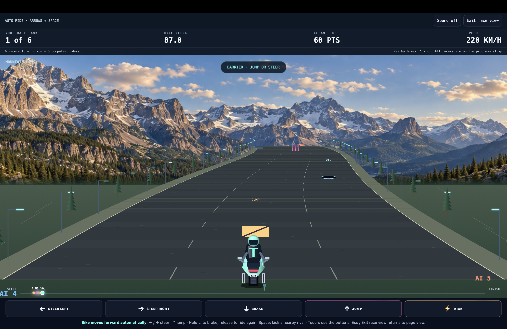

# Blackout Dash

Browser-based neon racing game prototype being developed for the Handshake AI Skills Studio x OpenAI Multiplayer Game Challenge.

## Gameplay Preview

## Current Features

- Neon-style browser racing experience
- Up to 8 riders
- Computer-controlled opponents
- Steering, jumping, braking, and kick mechanics
- Obstacles, speed, scoring, and race ranking
- Desktop and mobile controls
- Multiple road environments

## Controls

- **← / →** Steer
- **↑** Jump
- **↓** Brake
- **Space** Kick nearby rival
- Touch controls supported on mobile devices

## Status

**In Active Development**

The current version is a local prototype with computer-controlled riders. Real-time multiplayer, room-based gameplay, and cross-device synchronization are planned for the next development phase.

## Tech / Concepts

- HTML
- CSS
- JavaScript
- Canvas-based game rendering
- Responsive design
- Game logic and collision handling
- AI-assisted development

## Roadmap

- Real-time multiplayer support
- Room code system
- Cross-device synchronization
- Improved bike physics and speed feel
- Enhanced sound effects
- Live leaderboard
- Mobile optimization
- Additional race environments

## Developed By

**Bipul Dutta**
